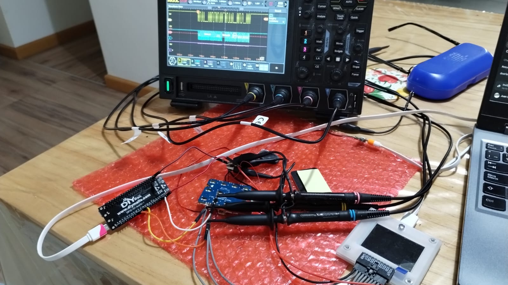
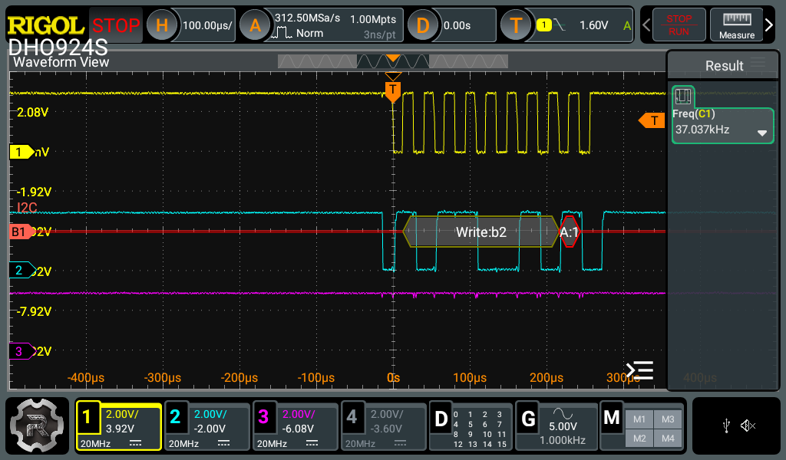

# GTX312L keypad component for ESP32-S3 (ESP-IDF)

ESP-IDF component for the GreenChip **GTX312L** 12-channel capacitive touch
controller (I2C), developed and validated against the touch panel of a
commercial smart lock ("TOUCH_BKN001T V2.1"). Every protocol fact in this
repo is **wire-proven**: the OEM behavior was captured with a PIO-based I2C
sniffer ([pico_i2c_sniffer](https://github.com/jjsch-dev/pico_i2c_sniffer))
and an oscilloscope before writing any code.

The project ships as `keypad_test`: the reusable component under
`components/keypad/` plus an interactive console harness that validates it
on real hardware.



## Features

- New ESP-IDF `i2c_master` driver (IDF v5.x / v6 / master).
- OEM-parity config presets (touch-active and low-power idle), including
  the undocumented register blobs the OEM writes, captured on the wire.
- Boot self-test: CHIP_ID (`0xB2`) + SENSITIVITY1 reset-value check, the
  same two checks the OEM CPU runs at power-on.
- INT-driven event engine: open-drain active-low INT wakes a FreeRTOS task,
  20 ms polling while active, ~6 s inactivity timeout back to idle config.
- Evidence-based key acceptance (debounce): an episode is accepted when the
  touch mask holds a resolvable key for >= 4 consecutive polls; ghost keys
  (the channel physically *below* the pressed one — measured pattern) are
  disambiguated away; RF/burst noise is rejected.
- Key event queue (`PRESSED` / `RELEASED` + timestamp) for the application.
- Touch masking API to mute the pad while an RF reader polls cards
  (13.56 MHz bursts inject touch noise — measured).
- All timing/sensitivity parameters in Kconfig (OEM parity defaults),
  overridable at runtime through `keypad_config_t`.

## Wiring (ESP32-S3-DevKitC-1 bench)

| Panel (GTX312L) | DevKitC-1 | Kconfig default |
|---|---|---|
| SDA | GPIO8 | `KEYPAD_SDA_GPIO` |
| SCL | GPIO9 | `KEYPAD_SCL_GPIO` |
| INT | GPIO4 (RTC-capable) | `KEYPAD_INT_GPIO` |
| VCC | 3V3 | |
| GND | GND | common ground is mandatory |

Notes:
- I2C clock defaults to **37 kHz (OEM parity)**. The panel relies on the
  GTX312L *internal* pull-ups (register `0Ch` reads `0x00` = enabled), so
  faster clocks need external pull-ups. The S3 internal pull-ups are
  enabled as a safety net.
- Pick an RTC-capable GPIO (0..21) for INT if you plan deep-sleep wake.

## Build and run

```bash
idf.py set-target esp32s3
idf.py menuconfig      # optional: keypad pin/timing parameters
idf.py flash monitor
```

## Console walkthrough (real session)

```
keypad> scan
scanning 7-bit address space 0x08..0x77:
  ACK at 0x59 (wire bytes W=0xB2 R=0xB3)

keypad> selftest
I (36338) gtx312l: self-test OK (CHIP_ID=0xB2, SENSITIVITY1=0x0F)
selftest: PASS

keypad> dump
GTX312L registers 01h..2Dh:
 01:B2 02:00 03:00 04:FF 05:3F 06:FF
 07:FF 08:FF 09:FF 0A:31 0B:00 0C:00
 0D:FF 0E:FF 0F:5A 10:01 11:32 12:FF
 13:05 14:03 15:03 16:FF 17:03 18:00
 19:01 1A:FF 1B:FF 1C:FF 1D:FF 1E:FF
 1F:FF 20:0A 21:0A 22:0A 23:0A 24:0A
 25:0A 26:0A 27:0A 28:0A 29:0A 2A:0A
 2B:0A 2C:0F 2D:0F
```

This dump matches the OEM's idle configuration 1:1 (pulse-mode INT,
500 ms calibration, 330 ms idle sensing, sensitivity 0x0A on all channels,
internal pull-ups enabled at `0Ch`).

```
keypad> monitor 500     # raw TOUCH_OUT, no debounce
t=  1940 ms  TOUCH_OUT=0x400  INT=1  2(K11)
t=  2200 ms  TOUCH_OUT=0x408  INT=1  5(K4) 2(K11)   <- ghost below
t=  2340 ms  TOUCH_OUT=0x400  INT=1  2(K11)
...

keypad> events 30       # debounced key events (D12 engine)
engine running for 30 s - touch the pad (events are debounced)
PRESSED  '2' t=4210 ms
RELEASED '2' t=4490 ms
engine stopped (OK)
stats: accepted=1 rejected_short=2 rejected_ambiguous=0
```

Scope check of the bring-up (37.037 kHz, address byte `0xB2`):



## Wire-proven facts (OEM reference behavior)

- 7-bit address `0x59` (wire `0xB2`/`0xB3`), CTRL pin OPEN.
- PCB silkscreen `K_n` = GTX312L channel n (bit n-1 of regs `02h`/`03h`),
  verified 12/12. Keypad layout: row1 `1`(K12) `2`(K11) `3`(K2),
  row2 `4`(K10) `5`(K4) `6`(K1), row3 `7`(K8) `8`(K9) `9`(K3),
  row4 `*`(K6) `0`(K7) `#`(K5).
- INT fires one ~5.5 ms pulse per TOUCH_OUT change (pulse mode after
  config; reset default `10h=0x11` is level mode).
- On first touch the CPU writes the touch-active config (sens `0x08`,
  ~11 ms sensing); after ~6 s without touch it writes the full idle burst
  (sens `0x0A`, 330 ms sensing) and sleeps.
- The OEM accepts a key after ~3-4 identical polls (~60-80 ms); stable
  ghost keys do not block acceptance. Ghosts are deterministic: the
  channel directly **below** the pressed key in the same column.
- Presenting an RF card injects bursty multi-channel noise; the OEM never
  reconfigures the chip during RF, so masking is done in software.

## Repository layout

```
keypad_test/
├── components/keypad/        the reusable component
│   ├── include/keypad.h      public API
│   ├── src/keypad.c          event engine + public API
│   ├── src/keypad_gtx312l.*  low-level chip driver
│   ├── Kconfig               OEM-parity defaults
│   └── README.md             component details
├── main/main.c               interactive console harness
└── docs/images/              bench evidence
```

## License

MIT — see [LICENSE](LICENSE).
